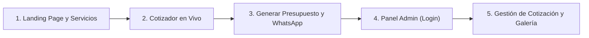

# 🏆 GUÍA MAESTRA DE DEFENSA UNIVERSITARIA
## Cristalería Aluvidrios Victoria Páez, C.A. (AVP)
### Proyecto Final: Aplicación Web Full-Stack con Cotizador y Gestión Comercial

---

## 🎯 1. El "Pitch" de Entrada (Los primeros 60 segundos)
> [!TIP]
> **Cómo iniciar tu presentación con seguridad y aplomo:**
> *"Buenos días, profesor. Nuestro proyecto no es una página web simulada con datos falsos. Desarrollamos una solución web Full-Stack real para **Cristalería Aluvidrios Victoria Páez, C.A.**, una empresa venezolana ubicada en La Victoria, estado Aragua, dedicada a la carpintería de aluminio y vidrio templado arquitectónico.*
>
> *Identificamos un problema recurrente en este rubro: los clientes no saben cómo cotizar cerramientos o divisiones de baño, las empresas pierden horas calculando presupuestos a mano y muchas ventas se enfrían en WhatsApp. Desarrollamos una plataforma integral con un **cotizador dinámico en tiempo real**, persistencia en **base de datos relacional SQLite**, integración con **WhatsApp API** y un **panel administrativo protegido** para gestionar clientes y obras en vivo."*

---

## 🏗️ 2. Arquitectura y Stack Tecnológico (Cómo está hecho)

### 🎨 A. Frontend (Interfaz y Experiencia de Usuario)
* **HTML5 Semántico:** Uso riguroso de etiquetas semánticas (`<header>`, `<nav>`, `<main>`, `<section>`, `<article>`, `<footer>`) que optimizan la accesibilidad y el SEO.
* **CSS3 Moderno & Glassmorphism:**
  * **Efecto Glassmorphism:** Paneles translúcidos con fondos semi-transparentes (`rgba(255, 255, 255, 0.75)` / `rgba(15, 23, 42, 0.75)`) y desenfoque óptico (`backdrop-filter: blur(12px)`), evocando visualmente el material principal del negocio: el vidrio.
  * **Diseño Responsive:** Basado en CSS Grid y Flexbox adaptable a teléfonos, tablets y computadoras de escritorio.
  * **Identidad Corporativa:** Paleta equilibrada en dos tonos estratégicos:
    * *Azul Cristal (`#0284c7`, `#06b6d4`):* Para elementos asociados al vidrio y títulos.
    * *Naranja Corporativo AVP (`#ea580c`):* Para botones de acción principal (CTA) y precios.
* **JavaScript Puro (Vanilla ES6+):**
  * Sin frameworks externos pesados: carga ultrarrápida.
  * Programación asíncrona (`async / await`, `fetch`) para consumir la API REST.
  * Manipulación reactiva del DOM mediante eventos (`input`, `change`, `click`).
  * Modal Lightbox dinámico para ampliar las fotos del portafolio.

---

### ⚙️ B. Backend (Lógica del Servidor y API REST)
* **Servidor Nativo en Python 3 (`server.py`) / Node.js (`server.js`):**
  * Desarrollado con librerías nativas estándar (`http.server`, `sqlite3`, `json`) sin dependencias de terceros (`zero-dependencies`). Corre en cualquier equipo sin ejecutar `npm install` ni `pip install`.
  * Diseñado bajo arquitectura **RESTful**:
    * `GET /api/servicios`: Consulta catálogo de servicios.
    * `GET /api/proyectos` & `POST /api/proyectos`: Gestión del portafolio de obras.
    * `DELETE /api/proyectos/<id>`: Eliminación de obras de la galería.
    * `GET|POST /api/cotizaciones`: Registro y lectura de cotizaciones.
    * `PUT|DELETE /api/cotizaciones/<id>`: Actualización de estado (*Pendiente, Contactado, Cerrado*) o eliminación.
    * `POST /api/admin/login`: Validación y emisión de sesión administrativa.
  * Cabeceras anti-caché configuradas para asegurar consistencia de datos en navegadores modernos.

---

### 🗄️ C. Base de Datos Relacional (SQLite3)
* **Motor:** SQLite3 (`database.sqlite`), motor relacional ligero y autocontenido (ACID).
* **Estructura Relacional (Tablas principales):**
  1. `cotizaciones`: Almacena el cliente, teléfono, ciudad, servicio, dimensiones ($m^2$), tipo de vidrio, acabado de aluminio, costo calculado, estado de atención y timestamp.
  2. `proyectos`: Catálogo de la galería pública (título, categoría, imagen, descripción).
  3. `mensajes`: Consultas directas del formulario de contacto.
* **Ventaja clave para la defensa:** Es un archivo portable (`.sqlite`), por lo que no requiere levantar servidores pesados tipo MySQL/XAMPP.

---

## 🎬 3. Guion de Demostración en Vivo (Paso a Paso)

Sigue este orden frente al profesor:

### Paso 1: Mostrar el Landing Page
* Muestra el Hero con la foto real de la fachada comercial y el logo corporativo.
* Desplázate a la sección **"Servicios Especializados"**: destaca las tarjetas de puertas de baño, ventanas panorámicas y barandas.
* Muestra la **Galería / Portafolio**: haz clic en los filtros (*Puertas de Baño, Ventanas, Barandas*) y haz clic sobre una imagen para abrir el **Lightbox (visor ampliado)**.

### Paso 2: La Joya de la Corona — El Cotizador en Tiempo Real
* Desplázate al **Cotizador Interactivo**.
* Dile al profesor: *"Aquí es donde el cliente interactúa con el sistema."*
* Cambia las medidas frente al profesor:
  * Ancho: `2.00` m | Alto: `1.80` m ➔ Muestra cómo el área cambia automáticamente a `3.60 m²`.
  * Cambia el tipo de vidrio de *Templado 8mm Claro* a *Templado 10mm Seguridad* (factor 1.30x).
  * Cambia el aluminio a *Acero Inoxidable 304* (factor 1.35x).
  * Señala el precio total: se actualiza al instante sin recargar la página.

### Paso 3: Guardar y Enlace WhatsApp
* Escribe datos de prueba:
  * Nombre: *Profesor [Apellido del profesor]* (¡esto siempre saca una sonrisa y demuestra dinamismo!).
  * Teléfono: *04141234567*.
* Haz clic en **"💾 Guardar Cotización en el Sistema"**:
  * Aparecerá la notificación verde tipo Toast.
* Haz clic en **"📲 Solicitar vía WhatsApp Oficial"**:
  * Muestra cómo se abre la URL de WhatsApp (`wa.me`) con el texto perfectamente redactado, con viñetas, medidas y precio en USD.

### Paso 4: Demostración del Panel de Administración
* Haz clic en **"Panel Administrativo"** en el pie de página o abre `admin.html`.
* Inicia sesión:
  * Usuario: `admin`
  * Contraseña: `admin123`
* Muestra el Dashboard:
  * **Tarjetas de Estadísticas:** Total cotizaciones, pendientes, valor estimado en USD.
  * **Tabla de Cotizaciones:** ¡Muestra la cotización que acabas de guardar con el nombre del profesor!
  * Cambia el selector de estado de `⏳ Pendiente` a `📞 Contactado`.
  * Muestra el botón verde de WhatsApp de la tabla (un clic para contactar al cliente).
  * Pestaña **"📸 Gestionar Galería y Obras"**: muestra cómo el administrador puede registrar una nueva obra o eliminar una existente con un solo clic.

---

## 📂 4. Si el Profesor pide abrir el código en "Bloc de notas"

Si el profesor te dice: *"Abre el código en Bloc de notas para ver qué hiciste"*, abre estos archivos clave con calma:

1. **[`frontend/index.html`](file:///C:/Users/aleja/OneDrive/Escritorio/Aluvidrios%20-%20Progra/frontend/index.html):**
   * Señala cómo las etiquetas están agrupadas de forma ordenada: `<nav>`, `<section id="cotizador">`, modales y pie de página con datos fiscales venezolanos.
2. **[`frontend/js/app.js`](file:///C:/Users/aleja/OneDrive/Escritorio/Aluvidrios%20-%20Progra/frontend/js/app.js):**
   * Ve a la función `calcularPresupuesto()` (línea 80): explícale la fórmula:
     $$\text{Total} = \text{Área} \times \text{Precio Base} \times \text{Factor Vidrio} \times \text{Factor Aluminio}$$
   * Ve a la función `enviarCotizacionAlBackend()` (línea 114): explícale la petición `fetch('/api/cotizaciones', { method: 'POST', body: JSON.stringify(...) })`.
3. **[`backend/server.py`](file:///C:/Users/aleja/OneDrive/Escritorio/Aluvidrios%20-%20Progra/backend/server.py):**
   * Señala la clase `APIHandler` con los métodos `do_GET`, `do_POST`, `do_PUT`, `do_DELETE` y las consultas SQL directas (`cursor.execute(...)`).

---

## 🧠 5. Banco de Preguntas Trampa y Respuestas Maestras

| Posible Pregunta del Profesor | Respuesta Recomendada |
|---|---|
| **¿Por qué usaron SQLite y no MySQL o PostgreSQL?** | *"Elegimos SQLite3 porque es un motor relacional embebido y serverless que cumple al 100% el estándar SQL y las propiedades ACID. Para una pequeña y mediana empresa como esta cristalería, reduce a cero los costos de administración de servidores, garantiza portabilidad total y soporta cientos de cotizaciones diarias con latencia casi nula."* |
| **¿Por qué usaron JavaScript puro (Vanilla) y no React/Vue?** | *"Para evitar la sobrecarga de dependencias (node_modules de cientos de megabytes) y optimizar el tiempo de carga. Con Vanilla JS demostramos dominio absoluto de los fundamentos web: manipulación directa del DOM, manejo de eventos asíncronos y consumo de APIs nativas con `fetch`."* |
| **¿Cómo aseguran que la página cargue rápido y se adapte a celulares?** | *"Diseñamos con filosofía Mobile-First utilizando CSS Grid, Flexbox y media queries. Además, las imágenes están optimizadas y se usa carga diferida (`loading='lazy'`) para no consumir datos innecesarios del cliente."* |
| **¿Qué pasa si el cliente no tiene conexión al servidor en ese instante?** | *"El sistema cuenta con un fallback (mecanismo de contingencia): si la API no responde, el cotizador sigue calculando en memoria y transfiere la cotización directamente por WhatsApp sin perder la venta."* |
| **¿Cómo se calculan los precios del cotizador?** | *"Establecimos una matriz de costos base por metro cuadrado según el rubro (ej: \$85/m² en baños, \$110/m² en fachadas) y multiplicamos por factores técnicos según el espesor del cristal (8mm vs 10mm) y el acabado de herrajes (aluminio mate vs acero inoxidable 304)."* |

---

## 🎙️ 6. Consejos de Actitud y Seguridad
* **Habla con propiedad de negocio:** No digas solo *"hice una función"*, di *"implementamos un módulo de cálculo automatizado para agilizar el embudo de ventas del negocio"*.
* **Ten a mano las credenciales:** Usuario `admin`, clave `admin123`.
* **Respira tranquilo:** Tu código está limpio, probado, conectado a GitHub y funciona tanto con servidor como directamente en el navegador.

¡A romperla en esa defensa! 🚀
